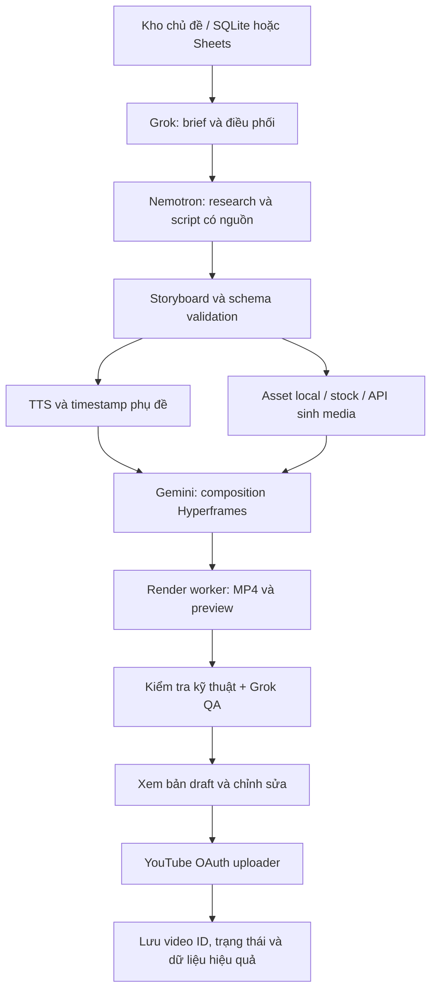

# Nguồn học và thiết kế hệ thống AI tạo video → YouTube

Ngày nghiên cứu: 13/10/2026. Dùng Exa với 9 truy vấn, yêu cầu tổng cộng 64 kết quả ứng viên; kết quả tìm kiếm không đồng nghĩa đã xem toàn bộ video. Đã đọc nội dung trích xuất/transcript của hai video gốc và đối chiếu các tài liệu chính thức quan trọng. Transcript tự động có lỗi phiên âm tên công cụ. Các hướng dẫn dưới đây là nguồn để học, không phải bằng chứng về thu nhập hoặc hiệu quả kênh.

## 1. Hai video bạn gửi thực sự đi theo hướng nào?

- [Weekend Build — Cách dùng Claude Opus tạo video motion graphics](https://www.youtube.com/watch?v=RD-tZMvpp9g): kết hợp agent viết nội dung/code với thư viện dựng video, asset và API sinh media.
- [Weekend Build — Tạo skill tự động làm video motion graphics](https://www.youtube.com/watch?v=KusqR4kxAqQ): tập trung Hyperframes, đóng gói hướng dẫn thành skill, kết hợp ảnh/video/giọng đọc.

Điểm nên học: tách “brain” khỏi engine render và nhà cung cấp media; skill mô tả quy trình sản xuất có thể tái sử dụng. Không cần mặc định mua Claude chỉ để làm theo ý tưởng này: Hyperframes có hướng dẫn cho nhiều coding agent. Chưa xác minh các tuyên bố 100 video/ngày, 100 USD/ngày hay chi phí 0,2–0,3 USD/video. Chi phí thực tế còn phụ thuộc API media, độ dài, số lần sinh lại và máy render.

## 2. Danh mục video nên học

Đánh giá “học gì” dựa trên nội dung/trích đoạn tìm được, chưa kiểm thử workflow của tác giả. Video cũ vẫn có giá trị kiến trúc, nhưng cần lấy lệnh và API hiện hành từ tài liệu chính thức. Các tiêu đề quảng cáo mạnh không được coi là cam kết kết quả.

### A. Hyperframes — sát nhất với hai video gốc

| Video / tác giả | Điều nên học | Ưu tiên |
|---|---|---|
| [Hyperframes Explained — Episode 1](https://www.youtube.com/watch?v=IDkycf5vfhI) — HeyGen | HTML/CSS/JS biến thành video, hiểu engine trước khi tự động hóa | Xem đầu |
| [Connect Hyperframes to Any AI Agent — Episode 2](https://www.youtube.com/watch?v=4iMWm0aOx8E) — HeyGen | Gắn engine với agent, phù hợp hướng thay Claude bằng tài nguyên của bạn | Xem đầu |
| [I Made a Video Using Only Code](https://www.youtube.com/watch?v=Z2xK0L-YDb0) — HeyGen | Luồng skill → mô tả → preview → MP4 | Tổng quan nhanh |
| [Create Insane AI Motion Graphics With Hyperframes + Claude Code](https://www.youtube.com/watch?v=eOhomP4vees) — Artificial Quotient | Setup và ví dụ motion graphics bằng prompt | Thực hành |
| [Hyperframes + Claude Code = The Most Powerful Editing Workflow](https://www.youtube.com/watch?v=MiFtKv8bF1M) — Maciej Dziuba | Vai trò asset, phong cách và điều chỉnh đầu ra | Học cải thiện chất lượng |
| [How To Build Full AI Videos with AI Agents](https://www.youtube.com/watch?v=9yx8Ja1gztI) — HeyGen | Kết hợp avatar/voice HeyGen với Hyperframes | Khi cần người dẫn |
| [Hyperframes Animation Agent Tutorial](https://www.youtube.com/watch?v=BvsdfVQJ7X4) — Alex Hitt | CLI và cách dựng video bằng code web | Bổ sung |

### B. Remotion — phương án thay thế khi muốn React và composition có cấu trúc

| Video / tác giả | Điều nên học |
|---|---|
| [Creating videos just from prompting](https://www.youtube.com/watch?v=Xtd4DjU9AU8) — Jonny Burger | Agent + Remotion, nền tảng của workflow bằng prompt |
| [Generate Animated Videos — Remotion Agent Skill Tutorial](https://www.youtube.com/watch?v=EwKCAgt4aKI) — Snapper AI | Khởi tạo project, cài skill, preview animation |
| [How I Vibe Code Technical Videos](https://www.youtube.com/watch?v=z7Bkf3Vc63U) — John Hartquist | Video giải thích kỹ thuật, giảm việc dựng thủ công |
| [Claude Just Changed Content Creation Forever](https://www.youtube.com/watch?v=M4cmrdoUKxI) — Sabrina Ramonov | Research, screenshot, sửa video và xuất bản; phần dịch vụ đăng bài có lợi ích thương mại của tác giả |
| [Ultimate Remotion Tutorial](https://www.youtube.com/watch?v=oWkUwno6b0E) — Chronixel | Xuất nhiều scene và đưa motion graphics vào editor |

Không chạy hai engine trong MVP. Chọn Hyperframes nếu ưu tiên nối tiếp video gốc; chọn Remotion nếu dự án đã dùng React hoặc cần composition theo dữ liệu. Đây là khuyến nghị thiết kế, không phải benchmark hai engine.

### C. n8n — học điều phối, API bất đồng bộ và upload

| Video / tác giả | Điều nên học |
|---|---|
| [Automate Faceless YouTube Videos — Beginner Course](https://www.youtube.com/watch?v=SjNAkOptNvs) — GenAI Unplugged | Sheets → script → image → clip → voice → render → publish |
| [Create Faceless Videos on Autopilot with AI + n8n](https://www.youtube.com/watch?v=MjZSsasHSq8) — Jono Catliff | Tách scene và trạng thái công việc trong Sheets |
| [How I Automated Faceless Shorts with AI](https://www.youtube.com/watch?v=Gc03J27xmBc) — Nate Herk | Gọi API tạo media, nhận task ID và lấy kết quả; API/model trong video 2025 cần cập nhật |
| [POV Faceless Videos System](https://www.youtube.com/watch?v=cc_e0bLbTX0) — AI Stack | Ví dụ schedule → topic → image/video → music → upload; không lấy lời hứa subscriber làm tiêu chí |

Với CLI agent qua gateway, không giả định node LLM của n8n gọi trực tiếp được mọi CLI. Có thể cần một adapter HTTP/worker nhận job và trả JSON đã kiểm tra schema.

### D. ComfyUI/Wan — nhánh nâng cấp khi thực sự cần cảnh sinh bằng AI

| Video / tác giả | Điều nên học |
|---|---|
| [Wan 2.1 VACE — text/image/video to video](https://www.youtube.com/watch?v=KGq96ag7FiY) — pixaroma | Hiểu các loại workflow video generation |
| [ComfyUI Video Models — Ep06](https://www.youtube.com/watch?v=Z8JlJdXdVg4) — pixaroma | Các pipeline video, avatar và lựa chọn cloud |
| [Animate Any Reference Image with a Video](https://www.youtube.com/watch?v=0trUwzli5G0) — Max Novak | Chuyển động từ video tham chiếu, workflow Wan 2.2 Animate |
| [Wan 2.2 Animate in ComfyUI](https://www.youtube.com/watch?v=tSaJuj0yQkI) — MDMZ | Thay nhân vật và giữ chuyển động tham chiếu |

Các clip này là nhánh bổ sung asset; không thay thế renderer, scheduler hay uploader. Chưa có thông tin GPU/VRAM của máy bạn nên chưa chọn cấu hình chạy local.

## 3. Tài liệu và repo để triển khai

| Nguồn chính | Dùng để làm gì | Điều cần chú ý |
|---|---|---|
| [Hyperframes GitHub](https://github.com/heygen-com/hyperframes) | Engine HTML/CSS/media → MP4, CLI và agent skills | Apache 2.0; theo README hiện hành, bắt đầu core skills |
| [Remotion agent skills](https://www.remotion.dev/docs/ai/skills) | Quy tắc composition, animation, captions, preview/render | Cài skill vào agent tương thích, không mặc định CLI nào cũng tự đọc được |
| [Remotion license](https://www.remotion.dev/license) | Xác định quyền dùng thương mại | Free cho cá nhân và một số tổ chức nhỏ; không gọi là miễn phí vô điều kiện |
| [MoneyPrinterTurbo](https://github.com/harry0703/MoneyPrinterTurbo) | Pipeline script, footage, TTS, phụ đề, nhạc, video; học kiến trúc dịch vụ | Kiểm tra README/version và provider bạn thực sự dùng; PR mở chưa phải tính năng đã có |
| [Short Video Maker](https://github.com/gyoridavid/short-video-maker) | REST/MCP, n8n examples, Pexels + TTS + Whisper + Remotion | README ghi voiceover tiếng Anh với kokoro-js; phải thay TTS cho tiếng Việt |
| [n8n faceless YouTube sample](https://github.com/aruntemme/n8n-faceless-youtube) | Workflow mẫu từ Sheets đến upload | Ví dụ không voice; không coi là hệ thống đầy đủ |
| [VieNeu-TTS](https://github.com/pnnbao97/VieNeu-TTS) | Nhánh giọng đọc tiếng Việt/Anh, local SDK | Chọn phiên bản ổn định; kiểm tra license từng checkpoint và quyền dùng giọng mẫu |
| [faster-whisper](https://github.com/SYSTRAN/faster-whisper) | Transcript và timestamp cho phụ đề | Đo lỗi tiếng Việt/tên riêng trên audio thực tế |
| [Wan 2.2 official ComfyUI workflows](https://docs.comfy.org/tutorials/video/wan/wan2_2) | Model và workflow T2V/I2V chính thức | GPU/VRAM tùy model và workflow; không suy ra từ cấu hình LLM cloud |
| [n8n YouTube node](https://docs.n8n.io/integrations/builtin/app-nodes/n8n-nodes-base.youtube/) | Upload/update video và các thao tác YouTube | Dùng HTTP Request nếu node không có trường API cần thiết |
| [Google: Upload a Video](https://developers.google.com/youtube/v3/guides/uploading_a_video) | Mẫu uploader OAuth bằng Python | Cần tài khoản kênh và credential OAuth |
| [Google: videos.insert](https://developers.google.com/youtube/v3/docs/videos/insert) | Các trường metadata, privacy, publishAt, synthetic media | Dự án API chưa audit có thể bị ép private |
| [Google: resumable uploads](https://developers.google.com/youtube/v3/guides/using_resumable_upload_protocol) | Upload tiếp khi mạng ngắt | Lưu session upload để tránh tạo bản upload mới khi retry |
| [YouTube monetization policies](https://support.google.com/youtube/answer/1311392) | Nội dung gốc, khác biệt và giá trị cho người xem | Nội dung hàng loạt/lặp lại có thể không đủ điều kiện kiếm tiền |
| [YouTube AI disclosure](https://support.google.com/youtube/answer/14328491) | Quyết định khi nào khai báo AI | Xem tiêu chí và ví dụ chính thức, không mặc định mọi hỗ trợ AI đều phải khai báo |

## 4. Thiết kế phù hợp ba agent của bạn

Đây là phân công đề xuất theo vai trò bạn nêu, chưa đo năng lực/tốc độ hoặc xác minh model ID của provider. Các ID được giữ nguyên như bạn cung cấp. Hiện chưa kết nối hoặc thực thi ba agent này.

| Agent | Trách nhiệm | Đầu ra giao cho bước sau |
|---|---|---|
| `grok-cli/grok-4.7` — brain | Chọn angle, lập brief, giao việc, duyệt storyboard, giải quyết mâu thuẫn và tổng hợp QA | `brief.json`, quyết định tiếp tục/sửa và lý do |
| `ollamacloud/nemotron-3-ultra` | Research có nguồn, kịch bản, kiểm tra claim, metadata và lời dẫn | `research.md`, `script.json`, `claims.json`, `metadata.json` |
| `antigravity/gemini-3.8-flash-tiered` | Viết code/template Hyperframes, nối media, sửa layout, preview, chạy render qua tools | Project composition, `render-manifest.json`, MP4 và ảnh preview |

Agent chỉ làm được nhiệm vụ tương ứng nếu môi trường cấp tool phù hợp: web cho research; filesystem/shell cho code và render; adapter/API cho gọi provider. Chưa biết gateway OmniRoute của bạn có endpoint/job interface gì nên phần kết nối là yêu cầu triển khai, không phải khả năng đã được xác nhận.

Ba agent LLM chưa đủ tạo tất cả media: cần thêm TTS, nguồn ảnh/clip/nhạc và máy render. MVP dùng đồ họa bằng code + asset có quyền sử dụng + TTS tiếng Việt; chỉ gọi video-generation API cho cảnh thật sự cần.



Grok điều phối nội dung/quyết định; scheduler quản lý trạng thái thật của job. Đừng để hội thoại của brain trở thành nơi duy nhất ghi nhớ công việc.

### Dữ liệu giao tiếp tối thiểu

```json
{
  "job_id": "vi-ai-001",
  "language": "vi",
  "format": "short",
  "target_duration_seconds": 45,
  "aspect_ratio": "9:16",
  "topic": "Một khái niệm AI giải thích bằng ví dụ",
  "sources": [],
  "scenes": [
    {
      "id": "s01",
      "narration": "Lời dẫn nguyên bản",
      "visual_type": "motion_graphics",
      "visual_brief": "Sơ đồ đơn giản minh họa ý chính",
      "asset_ids": [],
      "claim_ids": []
    }
  ],
  "budget_limit": null,
  "review_required": true
}
```

Đây là schema gợi ý, không phải API có sẵn. Điền nguồn thật và claim trước khi render. Thời lượng scene được tính sau TTS từ audio/timestamp, không đoán bằng số ký tự. Lưu version của script và hash asset để biết bản video nào ứng với bản duyệt nào.

### Trạng thái và độ tin cậy

`queued → researched → scripted → assets_ready → rendered → review → approved → uploaded → scheduled/published`; lỗi ở bất kỳ bước nào ghi `failed_stage`, `error`, `retry_count`.

- Mỗi job có thư mục riêng và manifest; chỉ một worker giữ khóa job tại một thời điểm.
- Retry có giới hạn và backoff. Không gọi lại sinh clip/TTS nếu asset hợp lệ đã tồn tại.
- Lưu task ID của API media, session upload và YouTube video ID; upload bị timeout phải đối chiếu trạng thái trước khi thử tạo mới.
- Giữ secrets trong credential store/env, không đưa token vào prompt, log hoặc repo.
- Giới hạn chi phí được thực thi ở adapter/worker, không chỉ nhắc trong prompt brain.
- LLM tự chấm điểm không chứng minh “viral”. QA cần kiểm tra âm thanh, phụ đề, nội dung, hình và quyền dùng media; hiệu quả phải đo sau khi đăng.

## 5. Lộ trình làm MVP

1. **Một format:** video giải thích 30–60 giây, 9:16, tiếng Việt, motion graphics. Chọn một chủ đề hẹp và một phong cách.
2. **Một video chạy local:** brief → script có nguồn → TTS → composition → MP4. Chưa cần n8n, avatar hoặc model sinh video.
3. **Một bộ 5–10 video thử:** đo thời gian, chi phí asset, số lần sửa, lỗi phát âm và lỗi render. Đây là kế hoạch thử nghiệm, không phải KPI đảm bảo.
4. **Đóng gói worker:** adapter cho ba agent, JSON schema, SQLite/job manifest, trạng thái, retry và lưu asset. Nếu muốn quản lý bằng giao diện, thêm n8n để gọi worker và điều phối.
5. **Upload private:** kiểm tra đúng kênh OAuth, metadata, trạng thái xử lý và xem video trên YouTube. Với dự án API bị giới hạn private, hoàn tất audit trước khi trông chờ lịch đăng public.
6. **Xuất bản theo lịch sau khi kiểm tra:** lưu AI disclosure/made-for-kids phù hợp nội dung, quyền sử dụng media; thu thập CTR/retention theo định dạng để sửa format.
7. **Mở rộng:** thêm I2V/avatars hoặc video dài khi format đầu có chất lượng ổn định.

### Tiêu chí chấp nhận bản thử

- MP4 đúng kích thước/thời lượng đã đo, đọc được trên player và YouTube sau upload.
- Lời dẫn tiếng Việt có dấu, phát âm tên riêng hợp lý, không bị nhạc lấn.
- Phụ đề khớp audio, không tràn khung hoặc bị giao diện Shorts che.
- Mỗi claim có nguồn hoặc được ghi rõ là ý kiến/ví dụ; không bịa chứng thực/số liệu.
- Preview gồm nhiều thời điểm và điểm chuyển cảnh; xem/nghe bản hoàn chỉnh trước khi duyệt.
- Có hồ sơ nguồn/license cho media; không lấy clip YouTube tham khảo làm asset khi chưa có quyền.
- Chạy lại cùng job không vô tình upload thêm bản trùng.

## 6. Các điểm YouTube ảnh hưởng trực tiếp đến thiết kế

Theo [videos.insert](https://developers.google.com/youtube/v3/docs/videos/insert), upload từ các dự án API chưa xác minh được tạo sau 28/07/2020 bị giới hạn private cho đến khi qua audit. Vì thế phải phân biệt OAuth đăng nhập thành công với quyền xuất bản public của dự án API.

Theo [chính sách kiếm tiền](https://support.google.com/youtube/answer/1311392), nội dung mass-produced/repetitive nằm trong nhóm inauthentic content. AI có thể hỗ trợ sản xuất, nhưng thay vài từ trên cùng template không tự tạo giá trị khác biệt.

Theo [AI disclosure](https://support.google.com/youtube/answer/14328491), nội dung thực tế bị tạo/chỉnh sửa đáng kể bằng AI cần khai báo theo tiêu chí của YouTube. Hỗ trợ viết outline/script/title hoặc caption không tự động thuộc diện khai báo; các cảnh thực tế giả, giả lời nói/hành động và những trường hợp audio được liệt kê cần đánh giá cụ thể. API có trường `status.containsSyntheticMedia`.

## 7. Thứ tự học ngắn nhất

Hyperframes Episode 1 → Episode 2 → làm một MP4 theo brief → GenAI Unplugged n8n → tài liệu Google Upload/resumable → mới học ComfyUI nếu thiếu cảnh sinh AI.

Trước khi triển khai cần chốt: niche, tiếng Việt/Anh, Shorts/video dài, máy render/GPU, ngân sách TTS/media và giao diện gọi ba agent qua OmniRoute. Những thông tin này không ngăn việc nghiên cứu nhưng quyết định cấu hình hệ thống thực tế.
